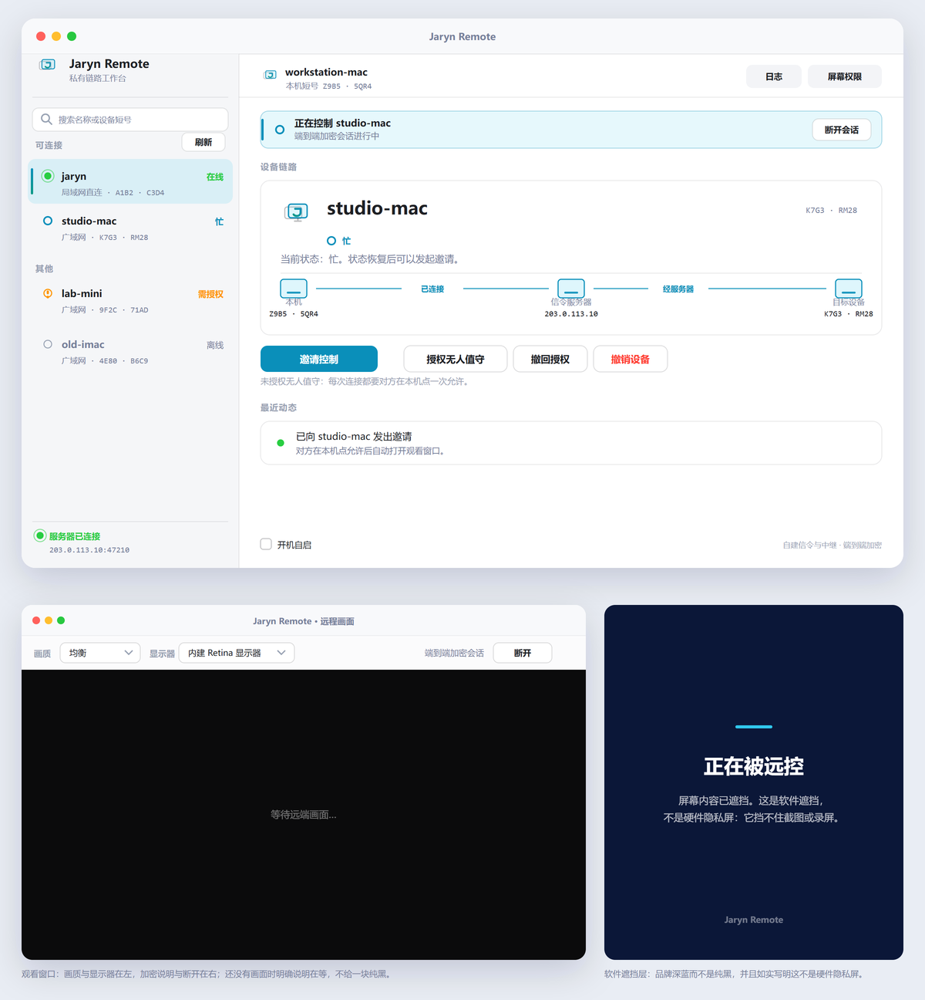
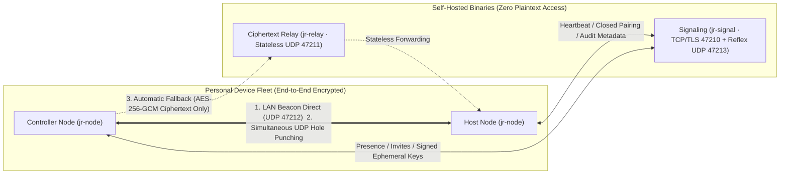

<p align="center">
  
</p>

<h1 align="center">Jaryn Remote</h1>

<p align="center">
  <strong>Self-hosted, end-to-end encrypted remote desktop, terminal &amp; file transfer for one owner's personal devices</strong><br>
  <sub>Clean-Room JRP/1 UDP Protocol · Native GPU Zero-Copy Pipeline · Zero-Trust Ciphertext Relay · Single-Binary Rust</sub>
</p>

<p align="center">
  <a href="https://github.com/ct-jaryn/jaryn-remote/actions/workflows/ci.yml"></a>
  <a href="https://www.rust-lang.org/"></a>
  <a href="docs/03-protocol.md"></a>
  <a href="#license"></a>
  <a href="https://github.com/ct-jaryn/jaryn-remote/stargazers"></a>
</p>

<p align="center">
  <a href="#why-i-built-this">Why I Built This</a> ·
  <a href="#design-highlights">Highlights</a> ·
  <a href="#architecture">Architecture</a> ·
  <a href="#quick-start">Quick Start</a> ·
  <a href="#self-hosting">Self-Hosting</a> ·
  <a href="#feedback--stars">Feedback</a> ·
  <a href="README.md"><strong>简体中文</strong></a>
</p>

---

> **This is a personal open-source project built from scratch.** If you find the protocol design, Rust architecture, or docs interesting, feel free to drop a **Star ⭐**!<br>
> Hit a bug, tried it on real hardware, or have an idea? Open an [Issue](https://github.com/ct-jaryn/jaryn-remote/issues) anytime — I'd love to hear your feedback.

---

## Why I Built This

All I wanted for my own machines was straightforward: **sit at whichever computer is in front of me and control my other paired devices with crisp text, responsive mouse input, quick file transfer, and a real PTY terminal — without routing my screen through a third-party vendor.**

Existing options always came with trade-offs I didn't want: commercial tools lock basic bitrate behind accounts and closed relays; generic WebRTC stacks are tuned for video calls rather than a `15–30ms` desktop latency budget; full-blown remote support suites carry massive codebases for stranger share-codes and WebView UIs.

So I built **Jaryn Remote** from the ground up in Rust:

- **100% clean-room stack**: Does not embed, wrap, or interoperate with RustDesk, Sunshine/Moonlight, ToDesk, scrcpy, or WebRTC. The wire protocol (`JRP/1`), selective ARQ, XOR FEC, JCC congestion control, UDP hole punching, and native OS adapters are all written from scratch.
- **Minimal server trust**: Two tiny self-hosted binaries (`jr-signal` and `jr-relay`). Media and control payloads are end-to-end encrypted (`X25519` + `Ed25519` + `AES-256-GCM`), and unattended grants (`JRP-GRANT1`) are signed locally by the host's private key — **even a compromised signaling server cannot decrypt frames or forge unattended access.**

<p align="center">
  
  <br>
  <sub>macOS native AppKit "Link Deck" workspace, viewer window, and honest software privacy overlay</sub>
</p>

---

## Design Highlights

- **Native OS Capture & Hardware Codecs**: `DXGI Desktop Duplication` + `D3D11 VideoProcessor` GPU zero-copy (`BGRA → NV12`) + `Media Foundation` H.264/AAC on Windows; `ScreenCaptureKit` + `VideoToolbox` + `AVAudioConverter` on macOS.
- **Decoupled 250Hz Cursor Channel**: Cursor coordinates and BGRA cursor shapes travel outside the video stream and composite locally — pointer movement stays snappy even when video bitrate drops.
- **Fast/Slow Stream Isolation**: Sub-1280-byte UDP packets avoid IP fragmentation; real-time video/audio never wait on reliable ARQ streams (clipboard, files, PTY, control).
- **Single-Binary Native UI**: One `jr-node` binary acts as both controller and host with native Cocoa/AppKit and Win32 windows — zero Electron or WebView overhead.
- **Closed Pairing (`--private`)**: Optional tokenless server mode using per-connection 32-byte TLS challenge signatures and time-boxed, single-use 8-character SSH approval codes.
- **Transparent & Fail-Safe**: Mandatory active-session indicators, manual-only clipboard send (no background snooping), automatic key-release timeouts, and crash-safe cleanup of software privacy overlays.

---

## Architecture



### Workspace Layout

| Path | Kind | Responsibility |
| --- | --- | --- |
| `crates/jr-proto` | Library | `JRP/1` wire codecs, constants, and 64-packet replay window (`#![forbid(unsafe_code)]`, zero syscalls) |
| `crates/jr-crypto` | Library | `ring`-backed Ed25519 identity, ephemeral X25519 handshake, HKDF-SHA256, AES-256-GCM, `JRP-GRANT1` grants |
| `crates/jr-transport` | Library | UDP packetizer, per-stream selective ARQ, adaptive XOR FEC, JCC congestion control |
| `crates/jr-session` | Library | Session state machine (video/audio slicing, input aging, SHA-256 atomic file transfer, clipboard, PTY) |
| `crates/jr-input` | Library | Cross-platform HID keycode mapping, multi-monitor origins, Retina physical-pixel transforms |
| `crates/jr-host-win` | Platform | Windows native adapter (DXGI + D3D11 zero-copy, MF H.264/AAC, SendInput & touch, ConPTY, Win32 UI & tray) |
| `apps/node` | Binary | Unified desktop & CLI node (includes macOS Objective-C ScreenCaptureKit/VideoToolbox/AppKit bridge) |
| `apps/signal` | Binary | Self-hosted TLS signaling server (presence, closed pairing, audit, LAN WoL forwarding) |
| `apps/relay` | Binary | Stateless ciphertext-only UDP relay with per-session bandwidth cap |

---

## Current Status

I keep a strict distinction between **automated CI tests passing** and **real two-machine hardware sign-off**:

| Platform | Role | Status |
| --- | --- | --- |
| **Windows** | Controller + Host | `jr-host-win` (DXGI + D3D11 zero-copy, MF H.264/AAC, SendInput + touch, ConPTY, Win32 device/viewer windows, tray, software cover) implemented; **full workspace unit & integration suite (including ConPTY resize & 8 MiB transfer) passing on Windows MSVC CI**; physical two-PC desktop screen/audio check pending |
| **macOS** | Controller + Host | Native Link Deck UI, viewer window, ScreenCaptureKit video/audio, VideoToolbox H.264, input injection, software cover, and `.app` bundler implemented & passing CI; physical two-Mac authorized screen/audio sign-off pending |
| **Linux** | Host (PTY + files) | Headless PTY terminal & SHA-256 file transfer passing Ubuntu CI; Wayland/X11 portal desktop capture planned (`TASKS.md` U03) |
| **Android / iOS** | Planned | Protocol capability bits reserved; mobile clients planned (`TASKS.md` U01–U02; iOS is controller-only by design) |

---

## Quick Start

```bash
# Terminal 1: Start signaling server (prints one-time fleet-token and cert-fingerprint)
cargo run -p jr-signal -- --data ./signal-data

# Terminal 2: Start controller node with native UI
cargo run -p jr-node -- --signal 127.0.0.1:47210 --data ./node-a --name alpha \
  --token <fleet-token> --pin <cert-fingerprint> --ui

# Terminal 3: Start host node
cargo run -p jr-node -- --signal 127.0.0.1:47210 --data ./node-b --name beta --accept \
  --token <fleet-token> --pin <cert-fingerprint>
```

---

## Self-Hosting

Open `47210/TCP` (TLS signaling), `47211/UDP` (ciphertext relay), and `47213/UDP` (NAT address reflection) on your server (RFC 5737 example IP `203.0.113.10`):

```bash
cargo run --release -p jr-signal -- --private \
  --data /var/lib/jaryn-remote/signal \
  --bind 0.0.0.0:47210 \
  --public-host 203.0.113.10 \
  --reflex-port 47213

cargo run --release -p jr-relay -- --bind 0.0.0.0:47211
```

See [deploy/](deploy/) for `systemd` units and [docs/01-product.md](docs/01-product.md)–[docs/11-node-refactor.md](docs/11-node-refactor.md) for full design & protocol docs (in Chinese).

---

## Feedback & Stars

- ⭐ **Give it a Star**: This is an independent hobby project — if you like the clean-room protocol, zero-bloat Rust design, or documentation, a **Star** means a lot!
- 💬 **Issues & Feedback Welcome**: Run into a build issue, tested it across two machines, or have suggestions on the protocol/code? Feel free to open an **[Issue](https://github.com/ct-jaryn/jaryn-remote/issues)** anytime.
- 🛠️ **Pull Requests**: Want to tinker or send a fix? Check [CONTRIBUTING.md](CONTRIBUTING.md) for design rules.
- 🔒 **Security**: Please report security vulnerabilities privately via [SECURITY.md](SECURITY.md).

---

## License

Dual-licensed under either of:

- **MIT License** ([LICENSE-MIT](LICENSE-MIT))
- **Apache License, Version 2.0** ([LICENSE-APACHE](LICENSE-APACHE))

at your option.
