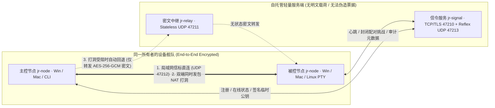

<p align="center">
  
</p>

<h1 align="center">Jaryn Remote</h1>

<p align="center">
  <strong>面向同一所有者的自托管、端到端加密个人设备舰队远控</strong><br>
  <sub>全栈自研 JRP/1 实时协议 · 原生 GPU 零拷贝采集与硬编解码 · 零信任密文中继 · 单二进制 Rust 实现</sub>
</p>

<p align="center">
  <a href="https://github.com/ct-jaryn/jaryn-remote/actions/workflows/ci.yml"></a>
  <a href="https://www.rust-lang.org/"></a>
  <a href="docs/03-protocol.md"></a>
  <a href="#许可证"></a>
  <a href="https://github.com/ct-jaryn/jaryn-remote/stargazers"></a>
</p>

<p align="center">
  <a href="#为什么做-jaryn-remote">设计初衷</a> ·
  <a href="#核心工程亮点">工程亮点</a> ·
  <a href="#系统架构">系统架构</a> ·
  <a href="#快速开始">快速开始</a> ·
  <a href="#公网自托管部署">自托管部署</a> ·
  <a href="#文档体系">文档体系</a> ·
  <a href="#支持与反馈">支持与反馈</a> ·
  <a href="README.en.md"><strong>English</strong></a>
</p>

---

> **喜欢这个项目的话，欢迎点亮右上角的 Star ⭐ 支持我们！**  
> 项目正在持续迭代打磨中，如果你在编译运行、跨端联调、真机体验中遇到任何问题，或者有架构与功能建议，非常欢迎随时提交 [Issue](https://github.com/ct-jaryn/jaryn-remote/issues) 交流反馈。

---

## 为什么做 Jaryn Remote？

大多数人日常需要的远控其实很简单：**在手头这台设备上，低延迟、安全可控地操作自己名下的其他电脑或服务器**——看清代码、指针跟手、传个文件、开个终端。

但现有方案往往让人两难：
- **商业远控**：绑定第三方账号体系、免费版限速限画质、闭源黑盒，敏感桌面流量经过不可控节点。
- **基于 WebRTC 的通用方案**：抖动缓冲与拥塞控制面向音视频会议调优，难以压进 `15–30ms` 桌面跟手预算。
- **传统全功能远控**：背负陌生人一次性协助码、多租户计费后台与重型 WebView 界面包袱，审计面过宽。

**Jaryn Remote 选择了一条极其克制、彻底自研的工程路线：**

不嵌入、不包装、不兼容任何第三方远控协议或 WebRTC 栈。从 `JRP/1` 线协议、多流可靠 ARQ、异或前向纠错（FEC）、拥塞控制（JCC），到双栈打洞、无状态密文中继和各系统原生硬件管线，全部用 Rust 与系统原生 API 从头构建，只服务「**同一所有者、一个私有设备舰队**」这一件事。

<p align="center">
  
  <br>
  <sub>macOS 原生 AppKit「链路台（Link Deck）」设备工作台、远程画面窗口与诚实标注边界的软件遮挡层</sub>
</p>

---

## 核心工程亮点

### 1. 全栈自研 `JRP/1` 低延迟线协议
- **单包免分片设计**：外层 28 字节路由头 + AEAD 密文严格控制在 `<= 1280` 字节以内，避免公网路径 IP 层分片放大丢包。
- **快慢流彻底隔离**：视频与音频走不可靠低延迟热通道（丢帧不堵队头）；能力协商、剪贴板、光标形状、文件块与终端数据走按流隔离的 **64 窗口选择性确认 ARQ**，传大文件时绝不卡住鼠标和终端。
- **自适应 XOR FEC 与 JCC 拥塞控制**：根据实时丢包千分比与 RTT 梯度每 `200ms` 动态调节编码码率、帧率台阶与异或冗余分组，宁可降码率保跟手，绝不堆高解码缓冲。

### 2. 原生硬件零拷贝管线 + 250Hz 独立光标通道
- **直驱系统底层 API**：Windows 采用 `DXGI Desktop Duplication` → `D3D11 VideoProcessor` GPU 内 BGRA→NV12 零拷贝 → `Media Foundation` 硬编解码 + `WASAPI` 系统音频回环；macOS 采用 `ScreenCaptureKit` → `VideoToolbox` 硬编解码 + `AVAudioConverter`。
- **指针永远跟手**：光标坐标（最高 `250Hz` 合并更新）与光标 BGRA 形状独立于视频流传输并在主控本地合成——即使在蜂窝弱网下把视频压到最低码率，鼠标移动依然丝滑不粘滞。
- **单进程原生界面**：一个 `jr-node` 二进制同时担任主控与被控，采用原生 Cocoa/AppKit 与 Win32 绘制窗口，零 Electron / WebView 内存负担。

### 3. 零信任服务端与不可伪造授权票据
- **信令与中继均不可读内容**：设备身份采用本机生成的 `Ed25519` 密钥对；每次会话通过签名临时 `X25519` 公钥完成双向握手，经 `HKDF-SHA256` 派生单向独立的 `AES-256-GCM` 媒体密钥。`jr-relay` 仅按随机 128 位匿名路由令牌原样转发密文。
- **双模式准入鉴权**：既支持开箱即用的 `fleet-token` 注册，也支持生产级 **`--private` 封闭配对模式**（无共享令牌，每次 TLS 连接执行 32 字节挑战签名，新设备须经服务器 SSH 开启限时单次窗口并核对 8 位码批准）。
- **被控端本地签名票据（`JRP-GRANT1`）**：无人值守权限不是服务端数据库里的布尔开关，而是由被控端私钥对「允许的设备公钥 + 能力位掩码 + 有效期」签发的密码学断言。**即便自建信令服务器被攻破，攻击者也无法解密任何一帧画面，更无法伪造无人值守授权。**

### 4. 透明、合规与故障安全自愈
- **绝不隐身控制**：首次连接须被控端本机确认；会话存续期间强制显示系统托盘/菜单栏指示；剪贴板仅在会话内手动触发同步，**绝不在后台静默监听日常复制**。
- **崩溃与断线兜底恢复**：键盘按下超时自动抬起、窗口失焦自动补发鼠标释放；断开、心跳超时或进程异常重启后，通过本地恢复标记自动清理残留输入与软件隐私遮挡层，杜绝「黑屏锁死」。

---

## 系统架构



### 模块分层（严格自下而上单向依赖）

| 模块路径 | 类型 | 职责边界 |
| --- | --- | --- |
| `crates/jr-proto` | 核心库 | `JRP/1` 线协议编解码、信令帧、常量与 64 包防重放窗口（`#![forbid(unsafe_code)]`，零系统调用） |
| `crates/jr-crypto` | 核心库 | `ring` 密码学封装：Ed25519 身份、临时 X25519 协商、HKDF、AES-256-GCM 与 `JRP-GRANT1` 票据验签 |
| `crates/jr-transport` | 核心库 | UDP 分包、多流选择性确认 ARQ、动态 XOR FEC、JCC 拥塞控制与路径评分 |
| `crates/jr-session` | 核心库 | 会话全生命周期状态机：音视频切片重组、输入时效过滤、SHA-256 原子文件传输、剪贴板、终端流 |
| `crates/jr-input` | 核心库 | 跨平台 HID 键码扫描表、多显示器原点映射与 macOS Retina 物理像素换算 |
| `crates/jr-host-win` | 平台层 | Windows 宿主与主控适配：DXGI + D3D11 零拷贝、MF H.264/AAC、SendInput/触控、ConPTY、Win32 窗口与托盘 |
| `apps/node` | 终端程序 | 统一桌面与命令行节点（含 `native/macos` Objective-C 原生采集/编解码与「链路台」界面桥接） |
| `apps/signal` | 服务端 | 自托管 TLS 信令、Presence 推送、`--private` 封闭配对审批、会话审计与局域网代发 WoL 魔包 |
| `apps/relay` | 服务端 | 纯内存无状态 UDP 密文中继（支持单会话带宽上限保护与空闲自动回收） |

---

## 平台支持与当前工程状态

我们坚持**绝对诚实的工程披露**：严格区分「自动化编译/单测/集成测试通过」与「多台物理真机端到端硬件验收通过」，不拿未实测路径冒充完成。

| 平台 | 支持角色 | 代码实现完成度 | 当前验证进展 |
| --- | --- | --- | --- |
| **Windows** | 主控 + 被控 | 屏幕枚举、DXGI + D3D11 零拷贝、MF H.264/AAC、SendInput + 触控、ConPTY、Win32 设备/观看窗口、托盘、软件遮挡层均已完成 | **全工作区单测与集成测试（含 ConPTY 交互、尺寸同步、8 MiB 传输）已在 Windows MSVC 真机及 CI 通过**；桌面窗口与双机端到端画面/声音待实机点检 |
| **macOS** | 主控 + 被控 | 原生「链路台」UI、观看窗口、ScreenCaptureKit 音视频采集、VideoToolbox 硬编解码、辅助功能注入、软件遮挡层、打包脚本均已完成 | **macOS CI 全量编译与集成测试通过**；尚待两台已授权录屏物理 Mac 完成真实画面、声音与延迟验收 |
| **Linux** | 被控为主（终端 + 文件） | 无桌面 PTY 终端、双向文件传输、信令重连与核心协议栈完整可用 | **Ubuntu CI 全量编译与集成测试通过**；Wayland / X11 桌面门户画面采集规划于第二阶段（`TASKS.md` U03） |
| **Android** | 主控 + 有限被控 | 协议能力位与前台通知安全约束已定稿 | 客户端待实现（`TASKS.md` U01） |
| **iOS / iPadOS** | 仅主控 | 协议层强制拒绝 iOS 作为被控端（`platform_not_hostable`） | 主控端待实现（`TASKS.md` U02） |

### 画质档位设计（CLI 与界面统一 `quality 1-4`）

| 档位编号 | 界面名称 | 典型场景 | 起点码率 | 码率上限 | 最高帧率 | 色度策略 |
| :---: | --- | --- | :---: | :---: | :---: | --- |
| `1` | **清晰** | 代码阅读、终端、文档办公 | 8 Mbps | 30 Mbps | 60 fps | 硬编支持则 `4:4:4`，否则回退 `4:2:0` |
| `2` | **均衡** | 日常综合办公（默认） | 8 Mbps | 20 Mbps | 60 fps | `4:2:0` |
| `3` | **高帧率** | 动态视频与流畅交互 | 16 Mbps | 50 Mbps | 120 fps | `4:2:0` |
| `4` | **省流量** | 蜂窝移动网络 / 跨国弱网 | 1.5 Mbps | 4 Mbps | 30 fps | `4:2:0` |

---

## 快速开始

### 环境准备

- **Rust 工具链**：建议使用最新 `stable`（`rustc 1.80+`）
  - **Windows**：需安装 Visual Studio C++ Build Tools（`x86_64-pc-windows-msvc`）
  - **macOS**：需安装 Xcode Command Line Tools（`xcode-select --install`，macOS 12.3+）
  - **Linux**：标准 C 编译链（`build-essential`）即可构建服务端与无桌面节点

### 30 秒本机三终端体验

打开三个终端窗口即可在本机跑通完整「信令注册 → 邀请确认 → 密钥协商 → 端到端会话」闭环：

```bash
# 终端 1：启动信令服务（首次启动会生成证书并一次性打印 fleet-token 与 cert-fingerprint）
cargo run -p jr-signal -- --data ./signal-data

# 终端 2：启动主控节点 alpha（--ui 打开原生桌面窗口）
cargo run -p jr-node -- --signal 127.0.0.1:47210 --data ./node-a --name alpha \
  --token <fleet-token> --pin <cert-fingerprint> --ui

# 终端 3：启动被控节点 beta（--accept 在本机联调时自动同意有人值守邀请）
cargo run -p jr-node -- --signal 127.0.0.1:47210 --data ./node-b --name beta --accept \
  --token <fleet-token> --pin <cert-fingerprint>
```

> 首次启动后，注册凭据与服务器证书指纹会以 `0600` 权限落盘到各自 `--data` 目录，下次重启只需执行 `cargo run -p jr-node -- --data ./node-a` 即可。

<details>
<summary><strong>展开查看：jr-node 全部交互式 CLI 命令速查表</strong></summary>

<br>

即使已通过 `--ui` 打开原生图形窗口，节点标准输入依然支持完整的交互控制命令：

| 分类 | 命令 | 说明 |
| --- | --- | --- |
| **设备与发现** | `list` | 列出舰队内设备名称、短号、状态与局域网/广域网可达性 |
| **发起与应答** | `invite SHORT` | 向目标短号发起有人值守远控邀请，打印双方一致的会话指纹 |
| | `invite-unattended SHORT` | 携带此前获授的签名票据发起无人值守连接 |
| | `accept` / `reject` | 在被控端同意或拒绝当前待决邀请 |
| | `end` / `quit` | 向对端发送 `Bye` 礼貌挂断当前会话 / 退出节点进程 |
| **授权与舰队** | `grant SHORT` / `ungrant SHORT` | 本机签发（默认 30 天）或立即撤回某台主控设备的无人值守权限 |
| | `revoke SHORT` | 从舰队彻底移除某台设备（仅共享令牌模式可用） |
| | `audit` | 查询与本机相关的历史会话审计摘要（不含画面与键鼠内容） |
| **画面与隐私** | `ui` / `view` / `watch` | 打开本机设备窗口 / 打开远程画面观看窗口 / 请求开始推流 |
| | `displays` / `display N` | 枚举远端显示器分辨率 / 无缝切换到第 `N` 块显示器（从 0 起） |
| | `quality 1-4` | 动态切换画质档（`1` 清晰 / `2` 均衡 / `3` 高帧率 / `4` 省流量） |
| | `privacy` | 请求被控端开启隐私遮挡 |
| **文件与剪贴板** | `file PATH` / `progress` / `cancel ID` | 发送文件（SHA-256 校验原子落盘）、查看发送进度、中途取消并清理临时文件 |
| | `clip TEXT` / `copy` | 发送指定文本 / 将本机当前剪贴板文本主动发往对端 |
| **远程终端** | `term` / `type TEXT` / `resize COLS ROWS` | 开启远端 PTY/ConPTY 终端、输入一行命令、同步终端行列尺寸 |
| **电源与系统** | `wake-mac AA:BB:CC:DD:EE:FF` / `wake SHORT` | 登记本机单播网卡 MAC / 请求同局域网在线节点代发唤醒魔包 |
| | `autostart on\|off` | 显式开启或关闭当前登录用户开机自启（默认关闭） |
| | `permit` / `stats` | 引导申请系统录屏/辅助功能权限 / 查看实时 RTT、帧计数与反馈统计 |

</details>

---

## 公网自托管部署

在拥有公网 IPv4（下文以 RFC 5737 示例地址 `203.0.113.10` 演示）的轻量云主机上部署两个静态二进制即可支撑整个个人设备舰队：

- **放行端口**：`47210/TCP`（TLS 信令）、`47211/UDP`（无状态密文中继）、`47213/UDP`（NAT 公网源地址反射探测）。

```bash
# 1. 编译发布版服务端
cargo build --release -p jr-signal -p jr-relay

# 2. 推荐使用 --private 封闭配对模式启动信令（零共享令牌，SSH 审批准入）
./target/release/jr-signal --private \
  --data /var/lib/jaryn-remote/signal \
  --bind 0.0.0.0:47210 \
  --public-host 203.0.113.10 \
  --reflex-port 47213

# 3. 启动无状态 UDP 密文中继
./target/release/jr-relay --bind 0.0.0.0:47211
```

### 打包 macOS 原生客户端（`Jaryn Remote.app`）

```bash
# 方式 A：构建通用客户端（首次双击打开弹出配置框，输入自建服务器地址与证书指纹）
./scripts/package-macos.sh

# 方式 B：构建绑定自建封闭配对服务器的客户端（免填参数，首次启动展示 8 位核对码供服务端审批）
./scripts/package-macos.sh --signal 203.0.113.10:47210 --pin <64位证书SHA256指纹>
```

完整的 `systemd` 守护进程配置见 [deploy/](deploy/)，SSH 限时配对审批（`--pair-open 600` / `--pair-approve`）与设备吊销流程详见 [docs/09-private-pairing.md](docs/09-private-pairing.md)。

---

## 文档体系

仓库内置了一套从产品边界、线协议字节布局到平台底层排障的完整设计文档（推荐按编号阅读）：

| 编号与文档 | 核心内容 |
| --- | --- |
| [01 · 产品规格](docs/01-product.md) | 产品定位、全平台能力矩阵、核心使用场景、15–30ms 延迟验收线与非目标边界 |
| [02 · 系统架构](docs/02-architecture.md) | 十大架构决定（D1–D10）、单进程原生模型、采集/编码/发送固定线程与故障域恢复 |
| [03 · JRP/1 协议规范](docs/03-protocol.md) | 全库常量唯一来源、外层/内层二进制头、握手派生公式、ARQ、FEC、JCC 与状态机 |
| [04 · 媒体与输入管线](docs/04-media-pipeline.md) | 逐段延迟预算拆解、GPU 采集循环、低延迟硬编意图、抖动缓冲与独立光标合成 |
| [05 · 身份、授权与安全模型](docs/05-security.md) | 密钥生命周期、封闭配对挑战、`JRP-GRANT1` 无人值守断言、隐私恢复与威胁处置表 |
| [06 · 平台适配器](docs/06-platforms.md) | Windows / macOS / Linux / Android / iOS 各端原生接口选型与权限降级策略 |
| [07 · 信令、中继与数据](docs/07-servers.md) | 信令职责边界、UDP 地址反射、无状态中继防挤占规则、SQLite 表结构与局域网降级 |
| [08 · 里程碑与路线图](docs/08-roadmap.md) | M0–M7 演进顺序、跨里程碑发布安全门槛与已知工程风险 |
| [09 · 封闭配对与部署指南](docs/09-private-pairing.md) | 生产自托管 `--private` 模式、8 位码单次配对审批、设备吊销与定长状态诊断 |
| [10 · macOS 链路台设计](docs/10-client-ui-v2.md) | 原生 AppKit「链路台」视觉语言、三重状态无障碍表达与键盘全流程操作 |
| [11 · 节点重构与回归记录](docs/11-node-refactor.md) | `jr-node` 模块化演进路线、边界收紧与跨平台缺陷修复档案 |
| [TASKS · 工程进度表](TASKS.md) | 已归档验证项与待实机/跨端推进清单（U01–U08） |

---

## 明确不做（Explicit Non-Goals）

清晰的反目标让代码库保持精简、可审计：

- **不做任何隐蔽或越权行为**：不绕过系统权限弹窗，不做免杀对抗，不隐藏被控状态图标，不后台静默读取剪贴板，不注入系统登录前安全桌面。
- **不做陌生人远程协助与商业后台**：不提供一次性公开协助码、账号密码体系、多租户计费或商业节点调度。
- **不留存隐私内容**：服务端与本机审计日志绝不记录屏幕像素、音频、按键序列、剪贴板文本或传输文件内容。
- **不做半成品 iOS 被控**：受限于 iOS 系统安全沙盒，明确不提供 iOS 被控端。

---

## 支持与反馈

开源项目的成长离不开真实的场景检验与直接的技术讨论：

- ⭐ **点个 Star 支持一下**：如果你认可 Jaryn Remote 的干净架构、自研协议文档或透明安全理念，欢迎在页面右上角点亮 **Star**——这是对项目最大的鼓励，也能让更多喜欢底层系统工程的朋友看到它！
- 🐛 **遇到问题欢迎随时提反馈**：无论你在编译打包、Windows / macOS 双机联调、NAT 打洞还是日常自托管中遇到任何 Bug、报错或体验卡点，都欢迎直接提交 **[Bug 反馈 Issue](https://github.com/ct-jaryn/jaryn-remote/issues/new?template=bug_report.yml)**。
- 💡 **功能建议与共建贡献**：有想法、改进建议或想参与真机验收 / 新平台适配（如阶段 3 独立媒体线程、Linux Wayland Portal 采集、Android/iOS 客户端），欢迎提交 **[功能建议 Issue](https://github.com/ct-jaryn/jaryn-remote/issues/new?template=feature_request.yml)** 或阅读 **[贡献指南 CONTRIBUTING.md](CONTRIBUTING.md)** 发起 Pull Request！
- 🔒 **安全漏洞私密披露**：若发现潜在密码学、认证或权限边界漏洞，请按 **[安全策略 SECURITY.md](SECURITY.md)** 通过 GitHub 私密安全通道上报。

---

## 许可证

本项目采用 Rust 社区标准的 **MIT OR Apache-2.0** 双许可证发布，你可自由选择其一适用：

- [MIT License](LICENSE-MIT)
- [Apache License, Version 2.0](LICENSE-APACHE)
