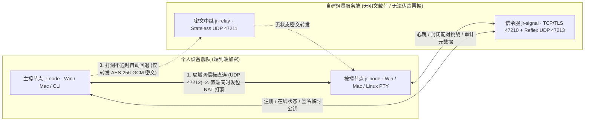

<p align="center">
  
</p>

<h1 align="center">Jaryn Remote</h1>

<p align="center">
  <strong>给同一所有者用的自托管、端到端加密个人远控</strong><br>
  <sub>全栈自研 JRP/1 实时协议 · 原生 GPU 零拷贝采集与硬编解码 · 零信任密文中继 · 单二进制 Rust 实现</sub>
</p>

<p align="center">
  <a href="https://github.com/ct-jaryn/jaryn-remote/actions/workflows/ci.yml"></a>
  <a href="https://www.rust-lang.org/"></a>
  <a href="docs/03-protocol.md"></a>
  <a href="#许可证"></a>
  <a href="https://github.com/ct-jaryn/jaryn-remote/stargazers"></a>
</p>

<p align="center">
  <a href="#为什么自己写一个远控">为什么自己写</a> ·
  <a href="#核心设计亮点">设计亮点</a> ·
  <a href="#系统架构">系统架构</a> ·
  <a href="#快速开始">快速开始</a> ·
  <a href="#公网自托管部署">自托管部署</a> ·
  <a href="#文档目录">文档目录</a> ·
  <a href="#交流与反馈">交流与反馈</a> ·
  <a href="README.en.md"><strong>English</strong></a>
</p>

---

> **这是一个我从零手搓的个人开源项目。如果觉得这套设计有意思或对你有启发，欢迎点亮右上角的 Star ⭐ 支持一下！**<br>
> 项目还在持续打磨中，不管是编译踩坑、真机测试反馈，还是对协议和代码有任何建议，都非常欢迎直接提 [Issue](https://github.com/ct-jaryn/jaryn-remote/issues) 交流。

---

## 为什么自己写一个远控？

我平时要在自己的几台电脑和服务器之间来回切换：看清代码、鼠标跟手、随手传个文件、开个终端。需求本身很纯粹，但现成方案总有让我别扭的地方：

- **商业远控**：强绑账号、免费档限码率限帧率、闭源黑盒，自己的桌面画面还得绕第三方节点。
- **套 WebRTC 的通用方案**：底层抖动缓冲和拥塞控制是为音视频通话调的，想压进 `15–30ms` 的桌面跟手预算非常拧巴。
- **大而全的传统远控**：背着陌生人临时协助码、多租户后台和重型 WebView 壳子，代码体量大，自己想改点底层逻辑很难下手。

所以我干脆按自己的标准从头写了 **Jaryn Remote**：

不嵌入、不包装、也不兼容任何第三方远控栈或 WebRTC。从底层的 `JRP/1` 二进制线协议、多流可靠 ARQ、异或前向纠错（FEC）、拥塞控制（JCC），到双栈打洞、无状态密文中继和系统原生硬件编解码管线，全部用 Rust 和操作系统原生接口手写实现，只专注做好一件事——**让一个人在任意一台自己的设备上，干净、低延迟地控制自己名下其余已配对的设备。**

<p align="center">
  
  <br>
  <sub>macOS 原生 AppKit「链路台（Link Deck）」设备窗口、远程画面窗口与如实说明边界的软件遮挡层</sub>
</p>

---

## 核心设计亮点

### 1. 从零设计的 `JRP/1` 低延迟线协议
- **单包免分片**：28 字节明文路由外层头 + AEAD 密文严格控制在 `<= 1280` 字节内，避免公网传输触发 IP 分片放大丢包。
- **快慢通道彻底解耦**：视频与音频走不可靠低延迟热通道（丢帧不阻塞后续帧）；能力协商、剪贴板、光标形状、文件分片与终端数据走按流独立的 **64 窗口选择性确认 ARQ**，传大文件时绝不拖慢鼠标与终端响应。
- **动态 XOR FEC + JCC 拥塞控制**：按实时丢包千分比和 RTT 梯度每 `200ms` 调节码率、帧率台阶与异或冗余比——宁可主动降码率保跟手，绝不把延迟堆进缓冲区换清晰。

### 2. 原生硬件零拷贝管线 + 250Hz 独立光标
- **直调系统与显卡接口**：Windows 走 `DXGI Desktop Duplication` → `D3D11 VideoProcessor` GPU 内 BGRA→NV12 零拷贝 → `Media Foundation` 硬编解码 + `WASAPI` 系统音频回环；macOS 走 `ScreenCaptureKit` → `VideoToolbox` 硬编解码 + `AVAudioConverter`。
- **光标独立于视频流**：指针坐标（最高 `250Hz`）和光标 BGRA 形状走独立通道并在主控本地合成——哪怕弱网下视频降帧降码率，鼠标依然丝滑跟手。
- **单二进制原生界面**：同一个 `jr-node` 既是主控也是被控，界面直接用原生 Cocoa/AppKit 与 Win32 绘制，不套 Electron 或 WebView。

### 3. 零信任中继与不可伪造的本地授权票据
- **服务端看不到任何明文**：每台设备在本机生成 `Ed25519` 身份密钥；每次会话通过双向签名的临时 `X25519` 公钥协商，经 `HKDF-SHA256` 派生收发独立的 `AES-256-GCM` 媒体密钥。`jr-relay` 只认 128 位随机路由令牌原样转发密文。
- **支持 `--private` 封闭配对**：除了常规的共享 `fleet-token` 模式，信令服还支持零共享令牌的封闭配对模式——每次 TLS 连接做 32 字节随机挑战签名，新设备加入时需我自己在服务器经 SSH 开启限时单次配对窗口并核对 8 位码放行。
- **被控端私钥签名票据（`JRP-GRANT1`）**：无人值守不是数据库里的一个布尔值，而是由被控端本机私钥签发的密码学断言，被控端每次本地验签并可随时秒级撤回。**就算自建信令服被攻破，既看不到画面，也伪造不出无人值守权限。**

### 4. 克制、透明、崩溃可自愈
- **绝不偷偷摸摸**：首次连接必须被控端本机点允许；会话期间保留托盘/菜单栏可见指示；剪贴板只在会话里手动触发发送，**不在后台静默监听日常复制**。
- **断线与崩溃兜底恢复**：键盘按下超时自动抬起、观看窗口失焦自动释放鼠标键；掉线、挂断或进程崩溃重启后自动清理残留输入与软件隐私遮挡层，防止黑屏卡死。

---

## 系统架构



### 目录与模块边界（从下往上单向依赖）

| 路径 | 类型 | 职责说明 |
| --- | --- | --- |
| `crates/jr-proto` | 核心库 | `JRP/1` 线协议编解码、信令帧、常量与 64 包重放窗口（`#![forbid(unsafe_code)]`，无系统调用） |
| `crates/jr-crypto` | 核心库 | 基于 `ring` 的 Ed25519 身份、临时 X25519 协商、HKDF、AES-256-GCM 与 `JRP-GRANT1` 票据验签 |
| `crates/jr-transport` | 核心库 | UDP 分包、多流选择性确认 ARQ、自适应 XOR FEC、JCC 拥塞控制与选路打分 |
| `crates/jr-session` | 核心库 | 会话状态机：音视频分片重组、过期输入丢弃、SHA-256 校验原子文件传输、剪贴板、终端流 |
| `crates/jr-input` | 核心库 | 跨平台 HID 键码表、多显示器物理像素原点换算与 macOS Retina 缩放换算 |
| `crates/jr-host-win` | 平台层 | Windows 适配层：DXGI + D3D11 零拷贝、MF H.264/AAC、SendInput/触控、ConPTY、Win32 窗口与托盘 |
| `apps/node` | 节点端 | 桌面与命令行统一节点（含 `native/macos` Objective-C 原生采集/编解码与「链路台」窗口桥接） |
| `apps/signal` | 服务端 | 自建 TLS 信令、在线同步、`--private` 封闭配对审批、审计记录与局域网代发 WoL 魔包 |
| `apps/relay` | 服务端 | 纯内存无状态 UDP 密文中继（带单会话带宽上限与超时自动回收） |

---

## 当前完成度与验证状态

代码写到哪一步、哪些过了 CI 自动化测试、哪些还没在两台物理机上真刀真枪跑过，我都如实写在下面，不拿「编译通过」冒充「真机验收」：

| 平台 | 角色 | 已实现内容 | 当前验证进展 |
| --- | --- | --- | --- |
| **Windows** | 主控 + 被控 | 屏幕枚举、DXGI + D3D11 零拷贝、MF H.264/AAC、SendInput + 触控、ConPTY、Win32 设备/观看窗口、托盘、软件遮挡层 | **全工作区单测与集成测试（含 ConPTY 交互与尺寸同步、8 MiB 文件传输）已在 Windows 真机及 CI 跑通**；桌面窗口点击与双机画面/声音待实机点检 |
| **macOS** | 主控 + 被控 | 原生「链路台」UI、观看窗口、ScreenCaptureKit 音视频、VideoToolbox 硬编解码、辅助功能注入、软件遮挡层、App 打包脚本 | **macOS CI 全量编译与测试通过**；尚待两台授权录屏的物理 Mac 跑通真实画面、声音与端到端延迟测量 |
| **Linux** | 被控为主（终端 + 文件） | 无桌面 PTY 终端、双向文件传输、信令重连与会话协议栈 | **Ubuntu CI 全量编译与测试通过**；Wayland / X11 桌面画面采集留待后续阶段（`TASKS.md` U03） |
| **Android** | 主控 + 有限被控 | 协议能力位与前台通知约束已预留 | 客户端尚未实现（`TASKS.md` U01） |
| **iOS / iPadOS** | 仅主控 | 协议层直接拒绝 iOS 被控（`platform_not_hostable`） | 主控端尚未实现（`TASKS.md` U02） |

### 四档画质（CLI 与界面统一 `quality 1-4`）

| 编号 | 名称 | 适用场景 | 起点码率 | 上限码率 | 最高帧率 | 色度 |
| :---: | --- | --- | :---: | :---: | :---: | --- |
| `1` | **清晰** | 看代码、终端、文档 | 8 Mbps | 30 Mbps | 60 fps | 硬编支持则 `4:4:4`，否则 `4:2:0` |
| `2` | **均衡** | 日常默认档 | 8 Mbps | 20 Mbps | 60 fps | `4:2:0` |
| `3` | **高帧率** | 动态画面 | 16 Mbps | 50 Mbps | 120 fps | `4:2:0` |
| `4` | **省流量** | 手机热点 / 蜂窝网络 | 1.5 Mbps | 4 Mbps | 30 fps | `4:2:0` |

---

## 快速开始

### 编译环境

- **Rust**：`stable`（`rustc 1.80+`）
  - **Windows**：安装 Visual Studio C++ Build Tools（`x86_64-pc-windows-msvc`）
  - **macOS**：安装 Xcode Command Line Tools（`xcode-select --install`，macOS 12.3+）
  - **Linux**：安装基础 C 工具链（如 `build-essential`）

### 本机三终端跑通流程

开三个终端就能在本机体验「信令注册 → 邀请确认 → 密钥派生 → 会话建立」的完整闭环：

```bash
# 终端 1：启动信令服（首次启动会打印一次 fleet-token 和 cert-fingerprint）
cargo run -p jr-signal -- --data ./signal-data

# 终端 2：启动主控节点 alpha（--ui 打开原生设备窗口）
cargo run -p jr-node -- --signal 127.0.0.1:47210 --data ./node-a --name alpha \
  --token <fleet-token> --pin <cert-fingerprint> --ui

# 终端 3：启动被控节点 beta（--accept 方便本机测试时自动同意有人值守邀请）
cargo run -p jr-node -- --signal 127.0.0.1:47210 --data ./node-b --name beta --accept \
  --token <fleet-token> --pin <cert-fingerprint>
```

> 首次连上后，令牌与证书指纹会以 `0600` 权限存进各自的 `--data` 目录，之后重启只传 `--data ./node-a` 即可。

<details>
<summary><strong>点此展开：jr-node 交互式命令行速查表</strong></summary>

<br>

开着 `--ui` 原生窗口时，终端标准输入也同时可用：

| 类别 | 命令 | 作用 |
| --- | --- | --- |
| **设备列表** | `list` | 查看舰队设备、状态文案及局域网/广域网标记 |
| **连接与挂断** | `invite SHORT` | 向目标短号发起有人值守邀请，打印双方会话指纹 |
| | `invite-unattended SHORT` | 用已获授的无人值守票据直接发起连接 |
| | `accept` / `reject` | 本机同意或拒绝收到的邀请 |
| | `end` / `quit` | 先发 `Bye` 挂断当前会话 / 退出整个节点进程 |
| **授权与审计** | `grant SHORT` / `ungrant SHORT` | 签发（默认 30 天）或立刻撤回某台设备的无人值守控制权 |
| | `revoke SHORT` | 从舰队移除设备（仅共享令牌模式可用） |
| | `audit` | 查看与本机有关的会话审计摘要（不含任何画面或键鼠内容） |
| **画面与遮挡** | `ui` / `view` / `watch` | 打开本机设备窗口 / 打开远程观看窗口 / 请求开始推流 |
| | `displays` / `display N` | 查看远端显示器分辨率 / 切到第 `N` 块屏（从 0 开始） |
| | `quality 1-4` | 切换画质档（`1` 清晰 / `2` 均衡 / `3` 高帧率 / `4` 省流量） |
| | `privacy` | 请求被控端开启隐私遮挡 |
| **文件与剪贴板** | `file PATH` / `progress` / `cancel ID` | 传文件（SHA-256 校验落盘）、看传输进度、取消并删掉对端临时文件 |
| | `clip TEXT` / `copy` | 发送一段文本 / 把本机当前剪贴板发给对端 |
| **远程终端** | `term` / `type TEXT` / `resize COLS ROWS` | 打开远端 PTY/ConPTY 终端、输入命令、调整终端行列尺寸 |
| **唤醒与自启** | `wake-mac AA:BB:CC:DD:EE:FF` / `wake SHORT` | 登记本机网卡 MAC / 让同网在线节点代发唤醒魔包 |
| | `autostart on\|off` | 显式开关当前用户登录自启（默认关） |
| | `permit` / `stats` | 申请系统录屏与辅助功能权限 / 查看当前 RTT 与收发帧统计 |

</details>

---

## 公网自托管部署

找一台有公网 IPv4（下面用文档示例 IP `203.0.113.10` 代替）的小服务器跑起两个进程即可，防火墙放行 `47210/TCP`（TLS 信令）、`47211/UDP`（密文中继）和 `47213/UDP`（NAT 地址反射）：

```bash
# 编译发布版
cargo build --release -p jr-signal -p jr-relay

# 推荐开启 --private 封闭配对模式（无共享令牌，新设备须经服务器本机审批）
./target/release/jr-signal --private \
  --data /var/lib/jaryn-remote/signal \
  --bind 0.0.0.0:47210 \
  --public-host 203.0.113.10 \
  --reflex-port 47213

./target/release/jr-relay --bind 0.0.0.0:47211
```

在 macOS（12.3+）上打包 `Jaryn Remote.app`：

```bash
# 通用包：首次打开弹窗填你自己的信令地址和证书指纹
./scripts/package-macos.sh

# 自用预置包：把你自己的封闭配对服务器地址和证书指纹编进 App，新设备经 SSH 核对 8 位码准入
./scripts/package-macos.sh --signal 203.0.113.10:47210 --pin <64位证书SHA256指纹>
```

`systemd` 配置示例放在 [deploy/](deploy/)，封闭配对审批命令（`--pair-open 600` / `--pair-approve`）见 [docs/09-private-pairing.md](docs/09-private-pairing.md)。

---

## 文档目录

写代码前我先把整套规格、线协议字节布局和边界想清楚写成了 11 篇文档，推荐按顺序读：

| 文档 | 内容概要 |
| --- | --- |
| [01 · 产品规格](docs/01-product.md) | 产品范围、各端能力矩阵、核心场景、15–30ms 验收线与明确不做的事 |
| [02 · 系统架构](docs/02-architecture.md) | 架构决定 D1–D10、单进程原生窗口模型、线程队列与故障恢复设计 |
| [03 · JRP/1 协议](docs/03-protocol.md) | 全库协议常量唯一来源、包头格式、密钥派生、ARQ、FEC、JCC 与状态机 |
| [04 · 媒体与输入管线](docs/04-media-pipeline.md) | 延迟预算拆解、GPU 采集循环、低延迟硬编参数、抖动缓冲与独立光标 |
| [05 · 身份、授权与威胁模型](docs/05-security.md) | 密钥管理、封闭配对挑战、`JRP-GRANT1` 签名票据、隐私恢复与威胁处置 |
| [06 · 平台适配器](docs/06-platforms.md) | Windows / macOS / Linux / Android / iOS 底层接口做法与权限降级 |
| [07 · 信令、中继与数据](docs/07-servers.md) | 信令职责、UDP 地址反射、无状态中继防挤占规则、SQLite 表结构 |
| [08 · 里程碑与路线图](docs/08-roadmap.md) | M0–M7 推进顺序、发布门槛与已知技术风险 |
| [09 · 封闭配对与自托管](docs/09-private-pairing.md) | `--private` 模式部署、8 位核对码单次审批、设备撤销与状态诊断 |
| [10 · macOS 链路台设计](docs/10-client-ui-v2.md) | 原生 AppKit「链路台」视觉设计、状态三重表达与全键盘交互 |
| [11 · 节点重构记录](docs/11-node-refactor.md) | `jr-node` 模块拆分方案、边界收紧与本地挖出的缺陷修复记录 |
| [TASKS · 任务清单](TASKS.md) | 已完成项归档与待真机/跨平台推进项（U01–U08） |

---

## 明确不做

把不做的事立在前面，防止范围膨胀：

- **不做任何隐蔽或越权功能**：不绕过系统权限弹窗，不做免杀，不提供隐藏图标或「对方无感知被控」，不后台偷听剪贴板，不注入登录前安全桌面。
- **不做陌生人协助与商业化后台**：不做一次性公开协助码，不做多租户、计费或节点调度后台。
- **不记录隐私载荷**：服务端与本地审计绝不落盘画面、声音、键鼠输入、剪贴板或文件内容。
- **不做 iOS 被控**：iOS 没有公开的后台整屏采集与触摸注入接口，不做半成品充数。

---

## 交流与反馈

这是我独立折腾的个人开源项目，非常希望能听到真实的使用反馈和技术交流：

- ⭐ **觉得不错欢迎点个 Star**：如果这个项目的自研协议、代码拆分或者设计文档合你胃口，欢迎随手在右上角点一颗 **Star**，这会给我很大动力继续往下完善！
- 💬 **遇到问题随时提反馈**：不管是编译报错、在你的 Windows / Mac 上真机跑出来的画面与延迟情况、NAT 打洞遇到特殊网络环境，还是觉得某处交互/代码可以改得更好，都欢迎直接提 **[Issue](https://github.com/ct-jaryn/jaryn-remote/issues)** 告诉我。
- 🛠️ **欢迎提 PR 一起折腾**：如果你想顺手修个 Bug，或者对独立媒体线程、Linux 桌面采集、手机端适配感兴趣，可以先看一眼 [CONTRIBUTING.md](CONTRIBUTING.md) 了解工程约束。
- 🔒 **安全问题私密联系**：如发现认证、加密或权限边界相关的安全漏洞，请通过 [SECURITY.md](SECURITY.md) 中的 GitHub 私密通道发给我，先不要直接发公开 Issue。

---

## 许可证

采用 **MIT OR Apache-2.0** 双许可证开源，可任选其一使用：

- [MIT License](LICENSE-MIT)
- [Apache License, Version 2.0](LICENSE-APACHE)
