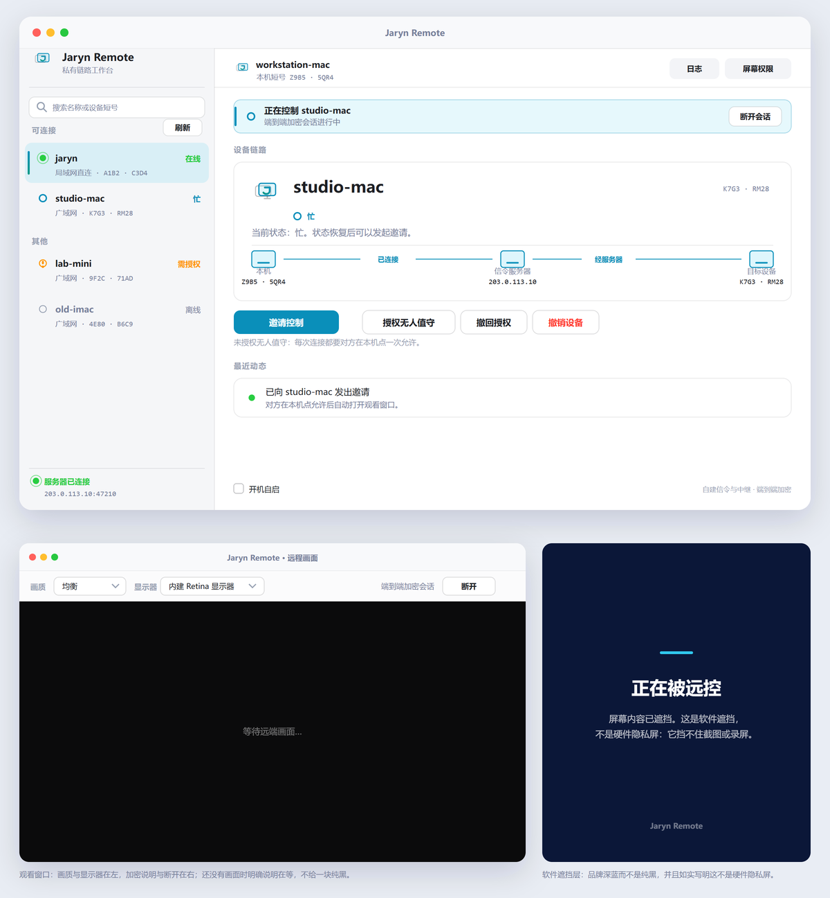

<p align="center">
  
</p>

<h1 align="center">Jaryn Remote</h1>

<p align="center">
  面向同一所有者的自托管个人设备舰队远控。<br>
  协议、会话状态机、传输控制、采集调度与输入注入全部自研，不依赖第三方远控栈。
</p>

<p align="center">
  <a href="https://github.com/ct-jaryn/jaryn-remote/actions/workflows/ci.yml"></a>
  <a href="#许可证"></a>
  <a href="README.en.md">English README</a>
</p>

---

## 项目简介

**Jaryn Remote** 是为个人多设备舰队设计的自托管远程控制与终端协作软件：人在自己的任意一台设备上，控制其余已经配对、并且操作系统显式允许被控的设备。

- **协议与核心栈完全自研**：自研 `JRP/1` 二进制线协议、可靠 ARQ 多流通道、异或前向纠错（FEC）、JCC 拥塞控制与路径选择（局域网信标直连 → UDP 反射打洞 → 自建无状态密文中继），不嵌入、不包装、不兼容 RustDesk、Sunshine/Moonlight、ToDesk、scrcpy 或 WebRTC 栈。
- **直接调用系统硬件管线**：屏幕采集与编解码走操作系统与显卡原生接口（Windows DXGI Desktop Duplication + D3D11 BGRA→NV12 GPU 零拷贝 + Media Foundation H.264/AAC；macOS ScreenCaptureKit + VideoToolbox + AVAudioConverter）。
- **端到端加密与最小信任服务端**：密码学基于 `ring` 实现 Ed25519 设备身份、临时 X25519 密钥协商、HKDF-SHA256 与 AES-256-GCM。所有者自建 `jr-signal`（信令）与 `jr-relay`（UDP 中继）；中继与网络路径仅见密文，无人值守授权票据由被控端私钥本地签发与校验，信令无法伪造。
- **单进程原生桌面体验**：桌面端采用同一节点二进制承载主控与被控角色，原生窗口绘制（macOS AppKit「链路台」、Windows Win32），无 Electron / WebView 运行时开销。

<p align="center">
  
</p>

---

## 仓库结构

```text
apps/
  node/              统一桌面与命令行节点（主控 + 被控，含 macOS Objective-C 原生桥）
  signal/            自托管 TLS 信令服务（在线状态、邀请转发、封闭配对审批、审计、WoL 代发）
  relay/             无状态 UDP 密文中继服务
crates/
  jr-proto/          JRP/1 线协议编解码、常量与防重放窗口（forbid(unsafe_code)，无 IO）
  jr-crypto/         Ed25519 身份、X25519 临时握手、AES-256-GCM 与签名无人值守票据
  jr-transport/      UDP 分片、多流可靠 ARQ、XOR FEC 与 JCC 拥塞控制
  jr-session/        端到端会话引擎（视频/音频、输入、双向文件传输、剪贴板、终端）
  jr-input/          跨平台 HID 键码映射与物理像素 / Retina 坐标换算
  jr-host-win/       Windows 原生适配层（DXGI 采集、D3D11 零拷贝、MF H.264/AAC、SendInput/触控、ConPTY、Win32 窗口与托盘）
deploy/              Linux systemd 服务单元示例（jr-signal / jr-relay）
docs/                01–11 完整产品规格、架构、协议、媒体管线、安全模型与重构记录
scripts/             macOS App 打包与图标生成脚本
```

---

## 平台与当前状态

项目坚持**验证透明原则**：自动化单元/集成测试与真实多物理机硬件验收严格区分标注。

| 平台 | 角色 | 当前代码与验证状态 |
| --- | --- | --- |
| **macOS** | 主控 + 被控 | 节点、原生「链路台」设备窗口、观看窗口、ScreenCaptureKit 采集、VideoToolbox 硬编解码、系统音频回环、软件遮挡层、唤醒按钮均已实现并通过编译与单测；尚待双机录屏授权真机端到端验收 |
| **Windows** | 主控 + 被控 | `jr-host-win`（屏幕枚举、DXGI + D3D11 GPU 零拷贝采集、MF H.264 编解码、WASAPI + MF AAC 音频、SendInput + 触控注入、ConPTY、设备窗口、观看窗口、系统托盘、软件遮挡层）已实现并通过编译与单测；尚待真机桌面交互与双机延迟验收 |
| **Linux** | 被控为主（无桌面走终端） | 无桌面 PTY 终端、双向文件传输与信令/会话核心栈可用；Wayland/X11 桌面画面采集尚未实现（见 `TASKS.md` U03） |
| **Android** | 主控 + 有限被控 | 协议能力位已预留，客户端尚未实现（见 `TASKS.md` U01） |
| **iOS / iPadOS** | 仅主控 | 协议拒绝 iOS 作为被控端（`platform_not_hostable`）；主控端尚未实现（见 `TASKS.md` U02） |

### 自动化测试已覆盖的核心链路

运行 `cargo test --workspace` 在进程内启动真实双节点、TLS 信令与 UDP 中继，验证：

- 设备注册、封闭配对挑战签名与单次审批、在线/离线/撤销状态同步、局域网组播信标发现
- 双方会话指纹一致性、伪造或越权无人值守票据拒绝、授权即时撤回
- 用户态对称/受限 NAT 同时发包打洞、不可达候选剔除、中继密文转发与路径静默自动切换
- 视频分片重组、XOR FEC 单包丢失恢复、关键帧请求与拥塞反馈闭环
- 剪贴板分片上限保护、8 MiB 双向文件逐字节 SHA-256 校验、中途取消不留残缺临时文件
- PTY 交互式终端回显与窗口尺寸同步（`TIOCSWINSZ` / ConPTY）
- 可靠流失败与挂断兜底释放（按键抬起、软件遮挡层清除）

---

## 核心能力与画质档

### 会话能力

- **设备状态明确区分**：在线、局域网直连、需授权、忙、版本不合、已撤销、离线各有独立状态与指示，不把权限缺失笼统标为离线。
- **显式授权与无人值守**：首次连接须被控端本机弹窗确认；无人值守控制需被控端事先签发 `grant` 票据，撤回后立即失效。
- **低延迟画面与独立光标**：光标位置与光标形状独立于视频帧传输并本地合成；视频码率受限时指针依然跟手。
- **双向文件传输与手动剪贴板**：文件经 SHA-256 校验后原子落盘，取消不留半截文件；剪贴板仅在会话内主动触发，绝不在后台静默监听日常复制。
- **远程终端与唤醒**：支持 PTY / ConPTY 终端会话，以及由同局域网在线节点代发 Wake-on-LAN 魔包。
- **可见指示与隐私遮挡**：会话期间保留可见指示与一键断开热键；当前桌面端提供诚实标注边界的软件遮挡层，断开或异常重启自动恢复屏幕。

### 四档画质（CLI 与界面统一 `quality 1-4`）

| 编号 | 档位 | 适用场景 | 起点码率 | 上限码率 | 最高帧率 |
| --- | --- | --- | --- | --- | --- |
| `1` | 清晰 | 代码阅读、文档办公 | 8 Mbps | 30 Mbps | 60 fps |
| `2` | 均衡 | 日常默认 | 8 Mbps | 20 Mbps | 60 fps |
| `3` | 高帧率 | 动态画面 | 16 Mbps | 50 Mbps | 120 fps |
| `4` | 省流量 | 蜂窝移动网络 | 1.5 Mbps | 4 Mbps | 30 fps |

---

## 快速开始

### 1. 本机双节点体验（共享令牌模式）

打开三个终端窗口：

```bash
# 终端 1：启动信令服务（首次启动会打印一次 fleet-token 与 cert-fingerprint）
cargo run -p jr-signal -- --data ./signal-data

# 终端 2：启动主控节点 alpha（--ui 打开原生设备窗口）
cargo run -p jr-node -- --signal 127.0.0.1:47210 --data ./node-a --name alpha \
  --token <fleet-token> --pin <cert-fingerprint> --ui

# 终端 3：启动被控节点 beta（--accept 自动同意有人值守邀请，方便本机联调）
cargo run -p jr-node -- --signal 127.0.0.1:47210 --data ./node-b --name beta --accept \
  --token <fleet-token> --pin <cert-fingerprint>
```

首次启动后，令牌与证书指纹以 `0600` 权限保存在各自 `--data` 目录，后续重启只需传入 `--data ./node-a` 即可恢复启动参数。

### 2. 公网自托管部署（信令 + 中继）

在拥有公网 IPv4（文档示例用 `203.0.113.10`）的自有服务器上运行 `jr-signal` 与 `jr-relay`，防火墙放行：

- `47210/TCP`：TLS 信令连接
- `47211/UDP`：端到端密文中继
- `47213/UDP`：NAT 公网地址反射探测（默认端口，可通过 `--reflex-port` 调整）

> 局域网发现另使用本地 `47212/UDP` 广播/组播信标，公网服务器无需放行。

```bash
# 生产自托管推荐使用 --private 封闭配对模式（无需分发共享 fleet-token）
cargo run --release -p jr-signal -- --private --data /var/lib/jaryn-remote/signal \
  --bind 0.0.0.0:47210 --public-host 203.0.113.10 --reflex-port 47213

cargo run --release -p jr-relay -- --bind 0.0.0.0:47211
```

systemd 服务文件示例见 [deploy/jaryn-signal.service](deploy/jaryn-signal.service) 与 [deploy/jaryn-relay.service](deploy/jaryn-relay.service)；封闭配对审批命令（`--pair-open` / `--pair-list` / `--pair-approve`）详见 [docs/09-private-pairing.md](docs/09-private-pairing.md)。

### 3. 打包 macOS 客户端

在 macOS（12.3+）上运行打包脚本生成 `Jaryn Remote.app` 压缩包：

```bash
# 构建通用客户端（首次打开弹窗填写信令地址、令牌与证书指纹）
./scripts/package-macos.sh

# 或构建绑定自建封闭配对服务器的客户端（免填配置，新设备经服务端 8 位码审批加入）
./scripts/package-macos.sh --signal 203.0.113.10:47210 --pin <cert-fingerprint>
```

### 4. 常用节点交互命令

节点运行期间（即使打开了 `--ui` 原生窗口），标准输入仍支持以下 CLI 命令：

```text
list                      列出舰队设备及在线/局域网状态
invite SHORT              向短号设备发起有人值守邀请
invite-unattended SHORT   使用已授予的无人值守票据发起连接
accept / reject           本机同意或拒绝待决邀请
grant SHORT / ungrant SHORT  授予或撤回某主控设备的无人值守控制权
revoke SHORT              从舰队撤销设备（非封闭配对模式下可用）
watch / view              请求远端画面流 / 打开本机观看窗口
displays / display N      查看远端显示器列表 / 切换到第 N 块显示器
quality 1-4               切换画质档（1 清晰 / 2 均衡 / 3 高帧率 / 4 省流量）
clip TEXT / copy          发送指定文本或本机剪贴板到对端
file PATH / progress / cancel ID  发送文件、查看进度、取消传输
privacy                   请求开启被控端隐私遮挡
term / type TEXT / resize COLS ROWS  打开远端终端、发送命令、调整终端尺寸
wake-mac AA:BB:CC:DD:EE:FF / wake SHORT  登记本机网卡 MAC / 唤醒睡眠设备
autostart on|off          显式开启或关闭当前用户登录自启（默认关）
stats / audit             查看当前链路统计 / 查询本机参与过的审计记录
end / quit                礼貌挂断当前会话（发送 Bye）/ 退出节点进程
```

---

## 文档导航

推荐阅读顺序：**产品规格 → 系统架构 → JRP/1 协议 → 媒体管线 → 安全模型**。

| 文档 | 说明 |
| --- | --- |
| [docs/01-product.md](docs/01-product.md) | 产品定义、设备能力矩阵、核心场景、体验验收线与非目标 |
| [docs/02-architecture.md](docs/02-architecture.md) | 系统架构决定 D1–D10、进程与线程边界、模块依赖关系 |
| [docs/03-protocol.md](docs/03-protocol.md) | `JRP/1` 线格式、握手派生、多流 ARQ、FEC、JCC 拥塞控制与状态机 |
| [docs/04-media-pipeline.md](docs/04-media-pipeline.md) | 15–30ms 延迟预算拆解、采集/硬编/重组/上屏与独立光标通道 |
| [docs/05-security.md](docs/05-security.md) | 身份密钥、封闭配对与票据签名、隐私恢复与威胁模型 |
| [docs/06-platforms.md](docs/06-platforms.md) | Windows / macOS / Linux / 移动端平台适配做法与失败降级 |
| [docs/07-servers.md](docs/07-servers.md) | 信令、中继、地址反射、局域网信标与 SQLite 数据模型 |
| [docs/08-roadmap.md](docs/08-roadmap.md) | M0–M7 里程碑定义、发布门槛与当前进度说明 |
| [docs/09-private-pairing.md](docs/09-private-pairing.md) | 自托管封闭配对（`--private`）、管理命令与 systemd 部署指南 |
| [docs/10-client-ui-v2.md](docs/10-client-ui-v2.md) | macOS 原生客户端「链路台（Link Deck）」界面与无障碍设计规范 |
| [docs/11-node-refactor.md](docs/11-node-refactor.md) | `jr-node` 模块化拆分方案、阶段进展与缺陷回归记录 |
| [TASKS.md](TASKS.md) | 已完成工程项归档与待真机/跨平台验收清单（U01–U08） |

---

## 明确不做（Non-Goals）

- **不越权、不隐藏**：不绕过操作系统权限弹窗，不做免杀对抗，不提供隐藏被控图标或「静默被控」模式，不后台监听日常剪贴板。
- **不做陌生人协助与商业多租户**：不提供一次性公开分享码、多租户计费后台或商业节点调度。
- **不录像、不留存敏感内容**：服务端与本机审计绝不记录画面、音频、键鼠事件、剪贴板或文件内容。
- **不控制 iOS 屏幕**：受限于 iOS 系统安全边界，明确不做 iOS 被控端或半成品屏幕广播。
- **不自造加密与编码算法**：密码学使用成熟库，视频/音频编解码使用操作系统与 GPU 原生接口。

---

## 参与贡献与安全反馈

- 贡献代码或文档前请阅读 [CONTRIBUTING.md](CONTRIBUTING.md)。
- 发现潜在安全问题请遵循 [SECURITY.md](SECURITY.md) 私密上报，勿在公开 Issue 披露未修复漏洞。

## 许可证

本项目采用 **MIT OR Apache-2.0** 双许可证发布，你可任选其一适用：

- MIT License（见 [LICENSE-MIT](LICENSE-MIT)）
- Apache License, Version 2.0（见 [LICENSE-APACHE](LICENSE-APACHE)）
