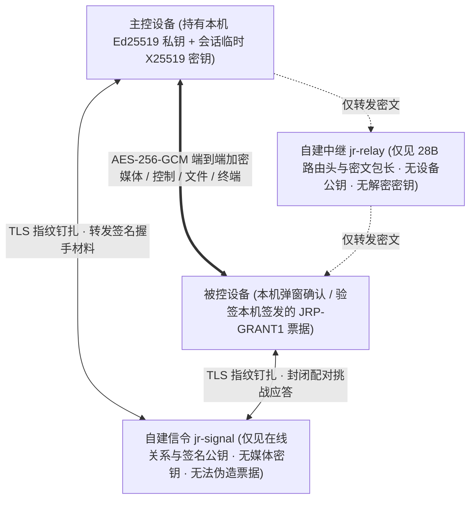

# 安全策略与信任边界（Security Policy）

Jaryn Remote 是一款面向**同一所有者的自托管个人设备舰队**远控工具。我们把「最小服务端信任、显式本机授权、无隐蔽驻留、故障可自愈」作为不可妥协的底层工程约束。完整威胁模型详见 [docs/05-security.md](docs/05-security.md)。

---

## 信任边界总览

### 密码学与协议安全基线

| 安全维度 | 实现方案 |
| --- | --- |
| **密码学库边界** | 统一调用成熟库 `ring`（禁止自造加密/扰码算法）；`jr-proto` 启用 `#![forbid(unsafe_code)]` |
| **设备身份与信令校验** | 设备首次启动本机生成 `Ed25519` 密钥对；节点对 `jr-signal` 执行严格 TLS 证书 `SHA-256` 指纹钉扎（Pinning），证书变更立即拒绝连接 |
| **会话密钥派生** | 每次会话生成一次性 `X25519` 临时密钥对并由双方 `Ed25519` 身份签名，经 `HKDF-SHA256`（绑定完整握手摘要）派生收发双向独立 `AES-256-GCM` 密钥，用完即弃 |
| **防重放与防篡改** | 外层序号单向递增 + 64 包滑动重放窗口；**先通过 AEAD 认证解密，再更新重放窗口与对端路径地址**，防止伪造包污染路由状态 |
| **无人值守授权（`JRP-GRANT1`）** | 由被控端本机私钥对 `host_id \|\| controller_id \|\| feature_bits \|\| not_before \|\| not_after` 签名，被控端本地独立验签并支持秒级撤回 |
| **合规透明与故障恢复** | 强制会话期可见指示、手动触发剪贴板（绝不后台监听日常复制）、键盘 500ms 未续期自动抬起、断开/崩溃重启自动清除软件隐私遮挡 |

---

## 支持版本

| 版本分支 | 安全修复支持 |
| --- | :---: |
| `0.1.x`（`main` 主干） | ✅ 支持 |

---

## 私密报告安全漏洞

如果你发现了可能影响保密性、完整性、认证边界或主机安全的漏洞（例如：握手/票据验签绕过、重放窗口绕过、文件传输路径穿越、内存安全缺陷、拒绝服务放大等）：

> [!IMPORTANT]
> 请**不要**在公开的 GitHub Issue 或 Pull Request 中直接披露未修复的漏洞细节。

请通过仓库的 **[GitHub Private Vulnerability Reporting（私密安全报告通道）](https://github.com/ct-jaryn/jaryn-remote/security/advisories/new)** 提交报告，并尽量附带：

1. **受影响模块**：如 `jr-proto`、`jr-crypto`、`jr-transport`、`jr-session`、`jr-signal`、`jr-node` 或 `jr-host-win`。
2. **复现条件与最小 PoC**：触发步骤、构造的数据包/配置或可复现的 Rust 单元测试。
3. **影响评估**：攻击者所需前置条件（如局域网嗅探、恶意中继、被攻破的信令服等）及潜在后果。

我们会在收到报告后尽快确认、推进修复，并在安全公告或更新记录中向报告者致谢！对于不涉及未公开漏洞利用的一般安全加固建议或疑问，也欢迎直接在 [Issues](https://github.com/ct-jaryn/jaryn-remote/issues) 中提出交流。

---

## 已知设计边界（非漏洞范围）

以下事项已在架构文档中明确定义并向用户如实告知，不属于安全漏洞：

- **自建信令服的元数据可见性**：完全控制 `jr-signal` 主机的攻击者可看到舰队中哪台设备在线、何时向谁发起过邀请（但无法解密会话内容，也无法签发无人值守票据）。
- **本机同用户权限边界**：已获得设备当前操作系统登录用户代码执行权限的进程访问本地数据目录。
- **桌面端软件遮挡层的物理定位**：在未安装专用虚拟显示器驱动时，macOS / Windows 当前采用置顶软件遮挡层遮蔽物理屏幕，遮挡层界面与文档均已明确提示其「挡不住系统截图与录屏」。
