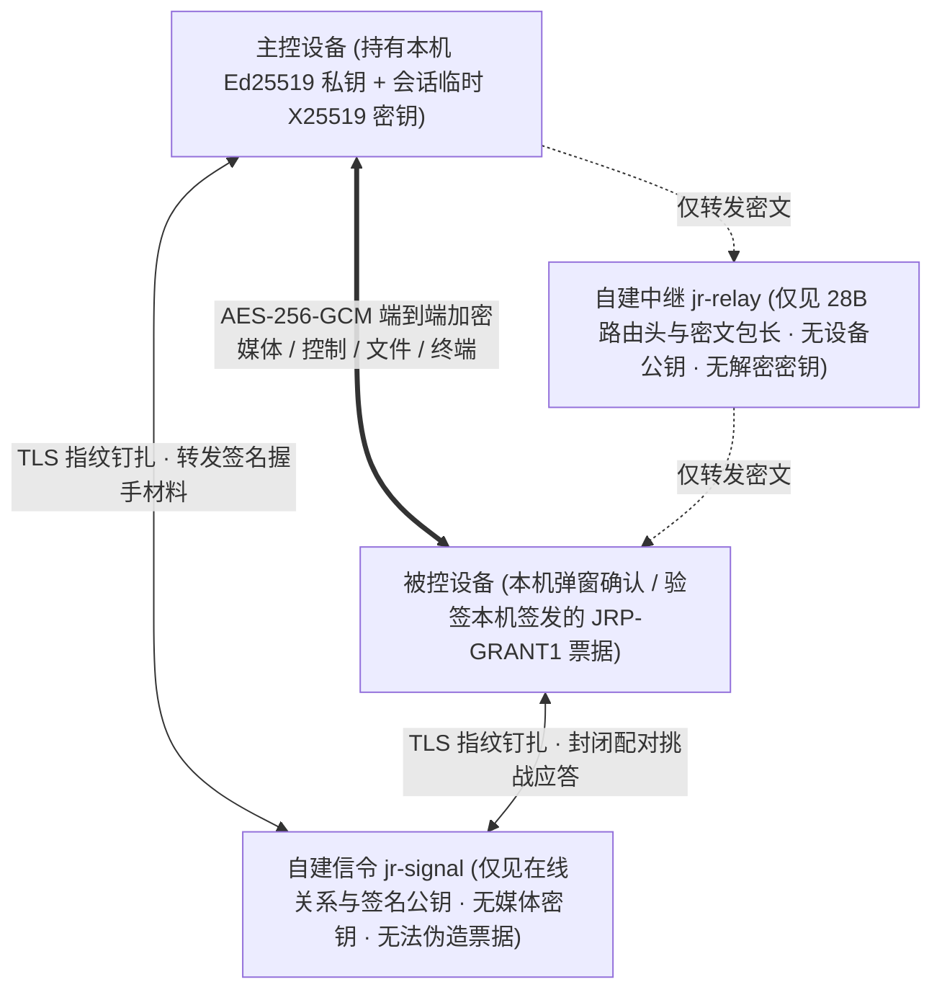

# 安全策略与信任边界（Security Policy）

Jaryn Remote 是我为**个人自托管设备舰队**编写的远控工具。整个项目在设计之初就把「最小服务端信任、显式本机授权、无隐蔽驻留、故障可自愈」定死为硬约束。完整威胁模型见 [docs/05-security.md](docs/05-security.md)。

---

## 信任边界总览

### 密码学与安全基线

| 维度 | 做法 |
| --- | --- |
| **密码学库边界** | 统一调用 `ring`，不自造加密或私有混淆算法；`jr-proto` 开启 `#![forbid(unsafe_code)]` |
| **设备身份与信令校验** | 设备首次启动在本机生成 `Ed25519` 密钥对；对 `jr-signal` 执行严格 TLS 证书 `SHA-256` 指纹钉扎（Pinning），证书变化直接拒绝连接 |
| **会话密钥派生** | 每次会话生成一次性 `X25519` 临时密钥对并由双方 `Ed25519` 身份签名，经 `HKDF-SHA256`（绑定完整握手摘要）派生收发独立 `AES-256-GCM` 密钥，会话结束即丢弃 |
| **防重放与防路由污染** | 外层包序号单向递增 + 64 包滑动重放窗口；**先通过 AEAD 认证解密，再推进重放窗口与对端地址**，防止伪造外层包污染路径 |
| **无人值守授权（`JRP-GRANT1`）** | 由被控端本机私钥对 `host_id \|\| controller_id \|\| feature_bits \|\| not_before \|\| not_after` 签名，被控端本地独立验签并支持秒级撤回 |
| **透明指示与故障恢复** | 强制会话期可见指示、手动触发剪贴板（不在后台监听日常复制）、键盘 500ms 超时自动抬起、断开/崩溃重启自动清理软件隐私遮挡 |

---

## 维护分支

| 版本 | 状态 |
| --- | :---: |
| `0.1.x`（`main` 分支） | ✅ 持续维护 |

---

## 私密报告安全问题

如果你在代码或协议里发现了安全漏洞（比如握手/票据验签绕过、重放窗口绕过、文件接收路径穿越、内存安全问题等）：

> [!IMPORTANT]
> 请先**不要**直接在公开 Issue 里贴出未修复的漏洞利用细节。

可以直接通过本仓库开启的 **[GitHub 私密漏洞报告通道（Private Vulnerability Reporting）](https://github.com/ct-jaryn/jaryn-remote/security/advisories/new)** 发给我，附上受影响的文件/模块和复现方式即可。我看到后会尽快确认并修复，修复后也很乐意在更新说明里向你致谢！

如果是日常的安全加固讨论或架构建议（不涉及未修复漏洞细节），直接开公开 [Issue](https://github.com/ct-jaryn/jaryn-remote/issues) 聊就行。

---

## 已知设计边界（非漏洞范围）

以下情况在设计文档里已经明确说明，不属于安全漏洞：

- **自建信令服的在线元数据**：攻破所有者自己的 `jr-signal` 主机能看到哪台设备在线、谁向谁发过邀请（但看不到画面内容，也签不出新的无人值守票据）。
- **本机同用户权限**：已经拿到设备当前登录用户执行权限的进程去读本机数据目录。
- **桌面端软件遮挡层**：没有装虚拟显示器驱动时，macOS / Windows 目前用的是置顶软件遮挡窗，界面和文档都已如实写明它只挡肉眼、挡不住系统截图或录屏。
